**English** · [中文](README.md)

# Still Today

Just want to see what's due, but have to open the browser, sign in and wait for a prompt on your phone every time?

Still Today is a small desktop widget, for Windows and Mac, for students whose university uses Canvas, the learning platform many universities use for courses, assignments and announcements. It keeps your Canvas assignments, deadlines and class schedule on your desktop, so you know what today holds without opening the browser.

https://github.com/user-attachments/assets/0310065c-c8b7-49bc-8fc3-10a0d07fedda

The video's captions are in Chinese.

- **No browser.** Assignments, deadlines, your class schedule and announcements are on the desktop, a glance away.
- **Syncs on its own.** Every 10 minutes. Submitted work is ticked off, and a new grade or announcement brings a notification.
- **Your data stays on your computer.** It reads Canvas with your own access token. No account, no server in between.

## What it does

### 1. Connect Canvas

- Type your school's name to find its Canvas, or paste your school's Canvas link if it isn't listed.
- Follow the three steps shown to create an access token, paste it in, and you're connected (step by step in [Connect Canvas](#connect-canvas)). You're reminded before the token expires.
- Some schools don't let students create tokens; if yours doesn't, Still Today can't connect for now.

| Finding Canvas by school name |
|:---:|
| 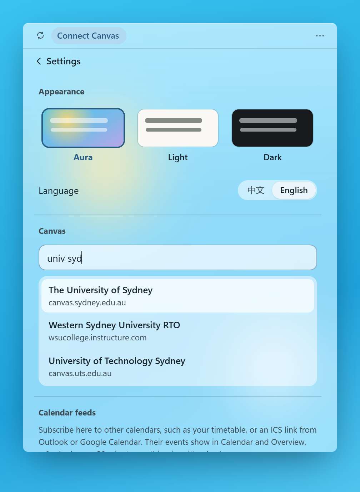 |

### 2. Assignments, from set to graded

- **Tasks:** every assignment and quiz from your courses, grouped by when it's due. Filter by course or search, and add tasks of your own.
- **Focus:** tie the timer to an assignment, and the time is recorded on it.
- **Hand in:** task detail has a button straight to the assignment on Canvas. Once you've submitted, it's ticked off at the next sync.
- **Grades and moved deadlines:** a posted grade brings a notification and shows on the task. If a deadline moves, the list moves with it.

| Tasks | Focus | Task detail |
|:---:|:---:|:---:|
| 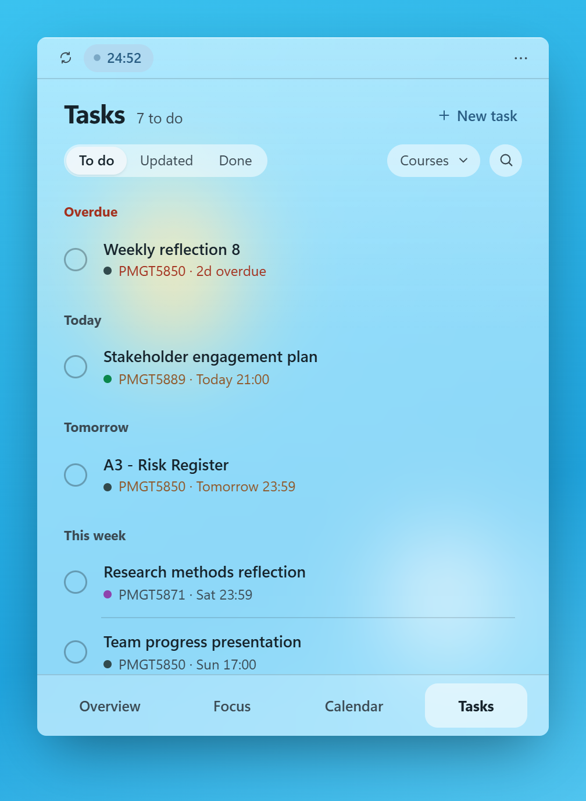 | 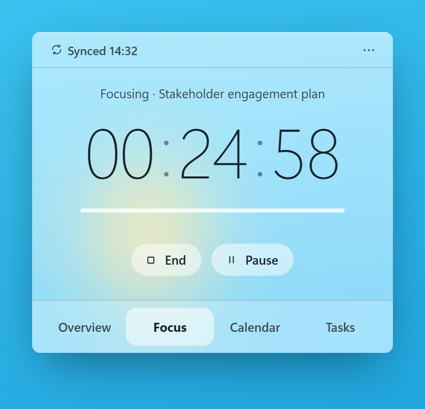 | 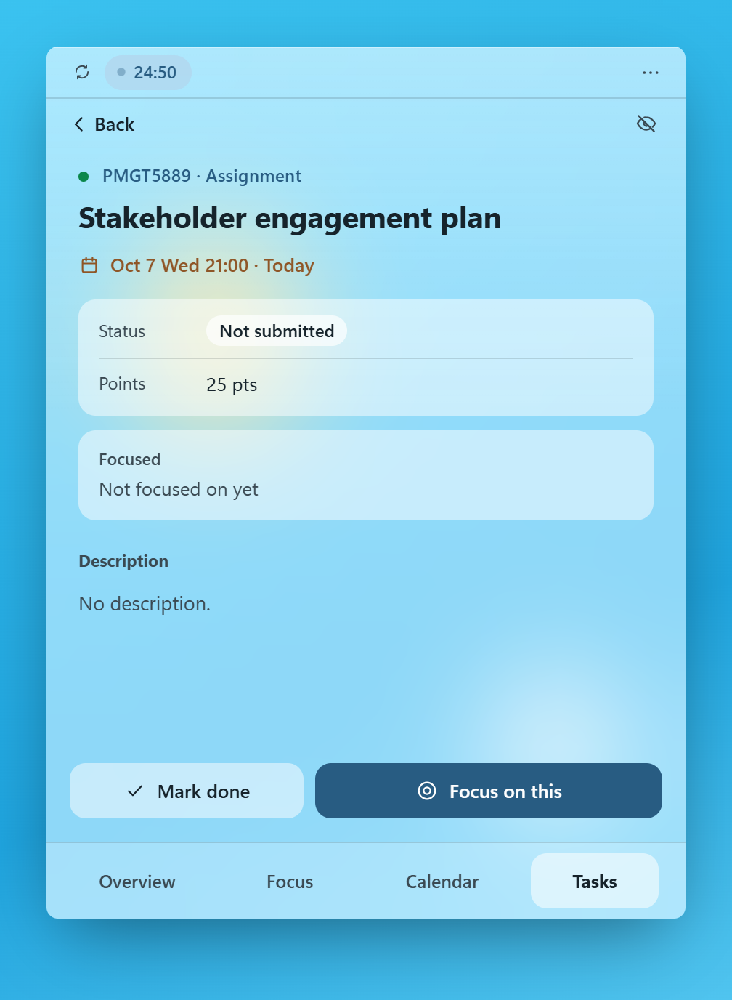 |

### 3. Calendar and announcements

- **Calendar:** the month view shows deadlines and Canvas course events. Add your own events too.
- **Feeds:** subscribe to your timetable, Outlook or Google Calendar. Settings explains where each keeps its feed link.
- **Announcements:** course announcements have their own page, with new ones marked and a notification when they arrive.

| Calendar | Calendar feeds | Announcements |
|:---:|:---:|:---:|
| 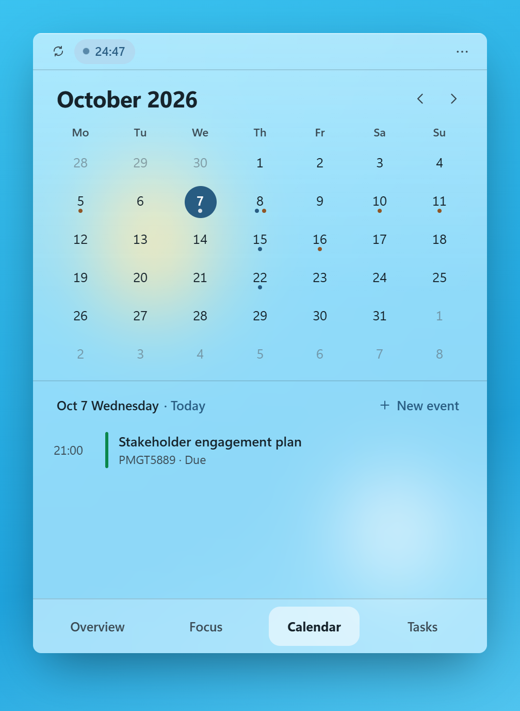 | 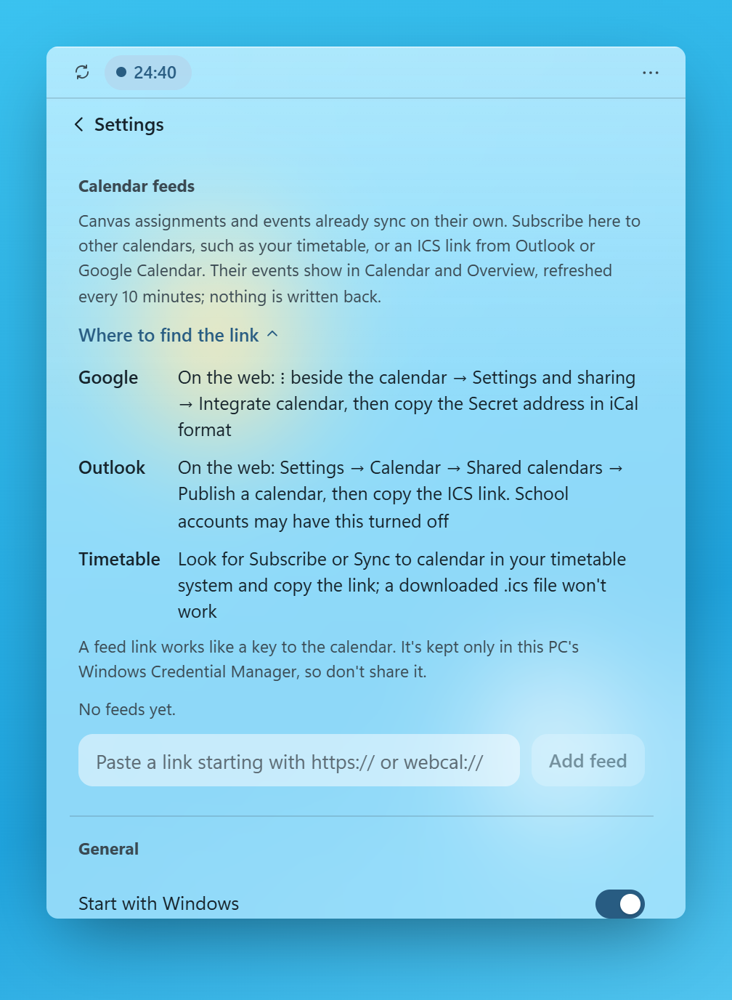 | 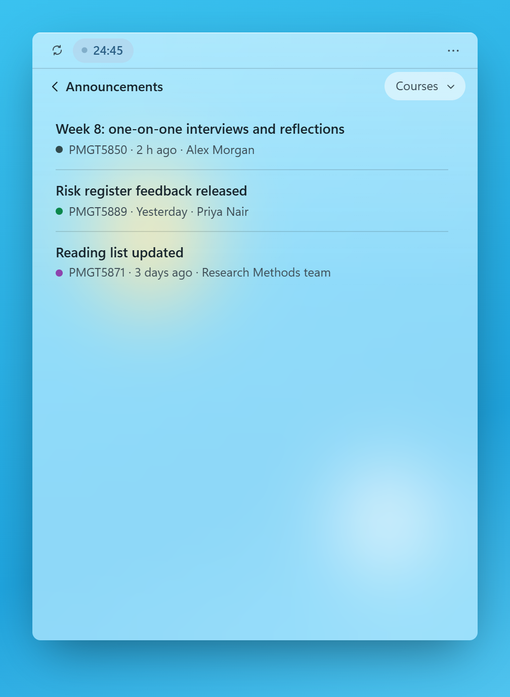 |

### 4. Overview: today at a glance

- The time, your next deadline, your next class or event, and how much is due in the next 7 days.
- The header shows when you last synced; tap it to sync. Assignment updates, new announcements and a running focus timer show there too, and a sync error or a token expiring within 14 days comes first.

| Overview |
|:---:|
| 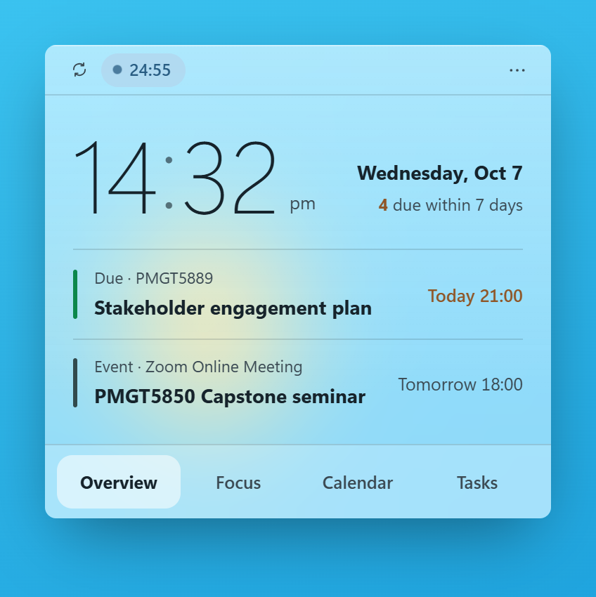 |

### 5. Look and settings

- The widget changes shape as you move between Overview, Tasks, Calendar and Focus.
- Three themes: Aura blurs the wallpaper behind the widget and picks light or dark text to match it; Light and Dark too.
- Rename a course whose Canvas name is too long, or hide one you don't need.
- Start at login, keep on top, lock its position, or hide it to the tray (the menu bar on a Mac). Chinese and English.

| Switching views | Renaming a course |
|:---:|:---:|
| 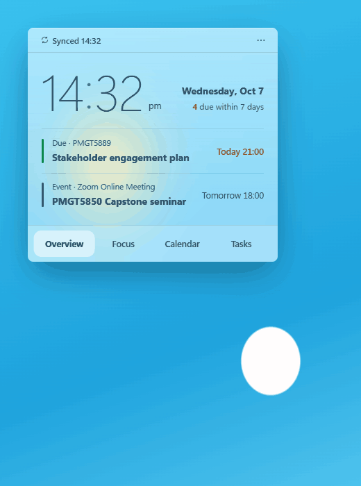 | 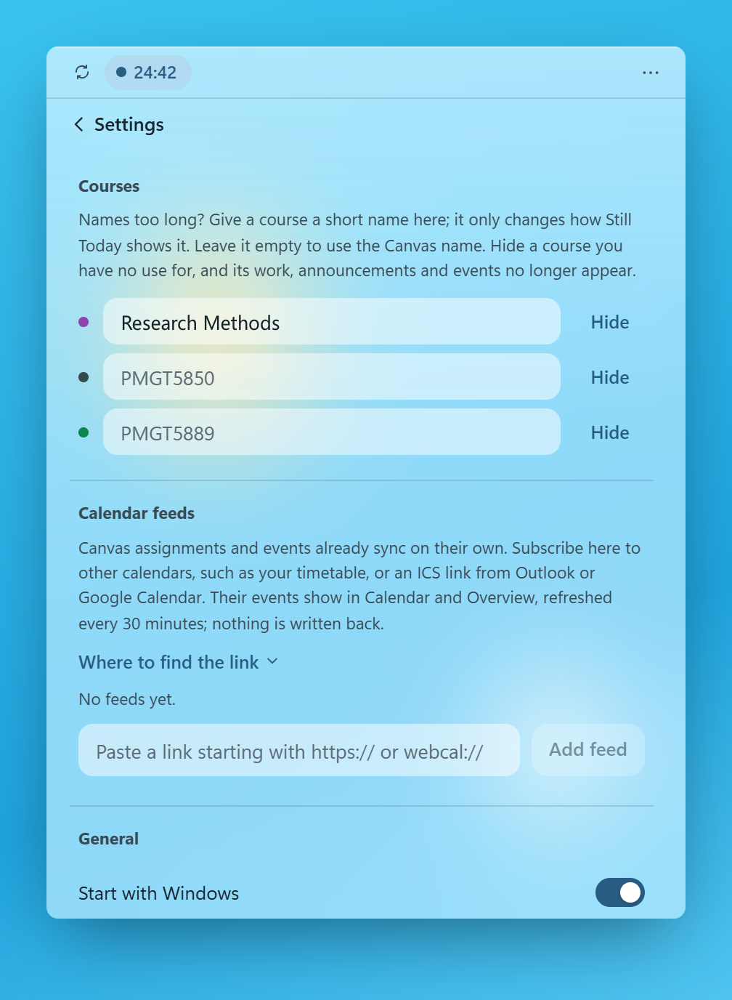 |

### 6. On the Mac: rounded corners and Liquid Glass

- The card's corners match the macOS desktop widgets, so it sits right beside them, and it keeps clear of them when you place it.
- On macOS 26 it uses the system's Liquid Glass, in two looks: Airy, tuned to the blur and colours of the system's own widgets, and Mist, softer. Each comes light or dark, or follows the system.
- It lives in the menu bar (a three-card icon), not the Dock.

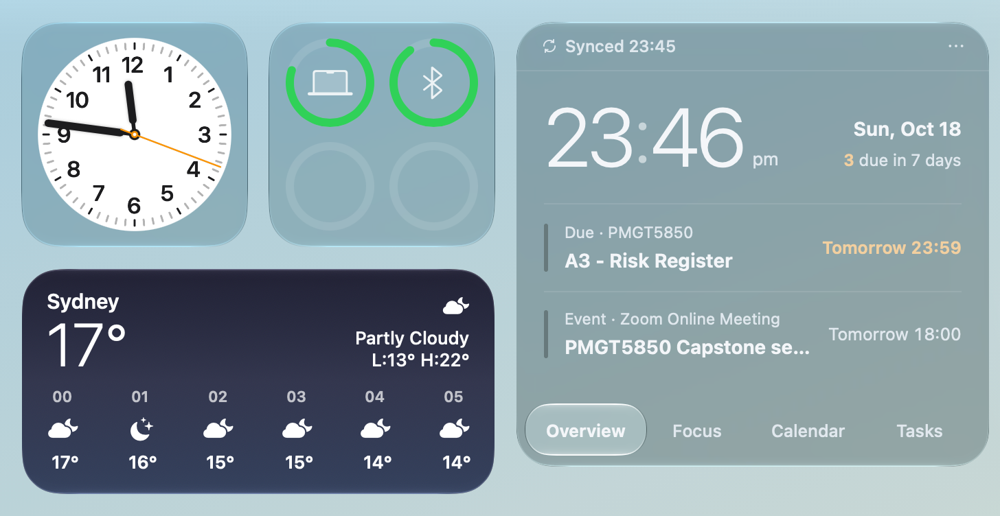

## Install

Get the installer for your computer from [Releases](../../releases/latest); Windows and Mac are on the same page.

### Windows

1. Download `StillToday-<version>-win-x64-setup.exe` and run it. It installs for your Windows user only and doesn't ask for administrator rights.
2. Windows may show **"Windows protected your PC"**. The installer isn't code-signed, so SmartScreen doesn't recognise it. Click **More info**, then **Run anyway**.
3. Connect your school as in "Connect Canvas" below.

**Requirements:** Windows 10 (version 1903 or later) or Windows 11. It runs on .NET Framework 4.8 and the WebView2 Runtime, which Windows already has, so the installer is about 2.5 MB.

### Mac

1. Download `Still-Today-<version>-mac.dmg`, open it and drag Still Today into Applications.
2. The first launch is blocked because it isn't notarized by Apple yet: go to **System Settings → Privacy & Security**, scroll down and click **Open Anyway** (on macOS 13/14 you can also right-click the app → Open). You only do this once.
3. It lives in the menu bar (a three-card icon), not the Dock.
4. Connect your school as in "Connect Canvas" below.

**Keychain password:** on a Mac your Canvas token is kept in the macOS Keychain, Apple's encrypted store for passwords. After an update (and sometimes after a restart), macOS may ask for your Keychain password on the first sync: that is your Mac login password. Enter it and choose **Always Allow**; with just Allow it asks again every time the app opens. It asks again after an update because Still Today isn't signed with an Apple developer ID yet, so macOS treats each new version as a new app.

**Requirements:** macOS 13 or later, on Apple silicon or Intel.

## Connect Canvas

Once it's installed, these four steps connect the widget to your school's Canvas. You only do this once.

### Step 1: Find your school

Click **···** at the top right of the widget → **Settings**, type your school's name in the Canvas box, and pick your school. For the University of Sydney, `univ syd` is enough. If it isn't listed, paste your school's Canvas link instead.


### Step 2: Create a token in Canvas

Click **Open Canvas settings**. Your browser opens Canvas's Settings page (sign in first if asked). Scroll down to Approved Integrations; **+ New Access Token** is at the bottom of that list. Click it.

| In the widget | Canvas settings |
|:---:|:---:|
| 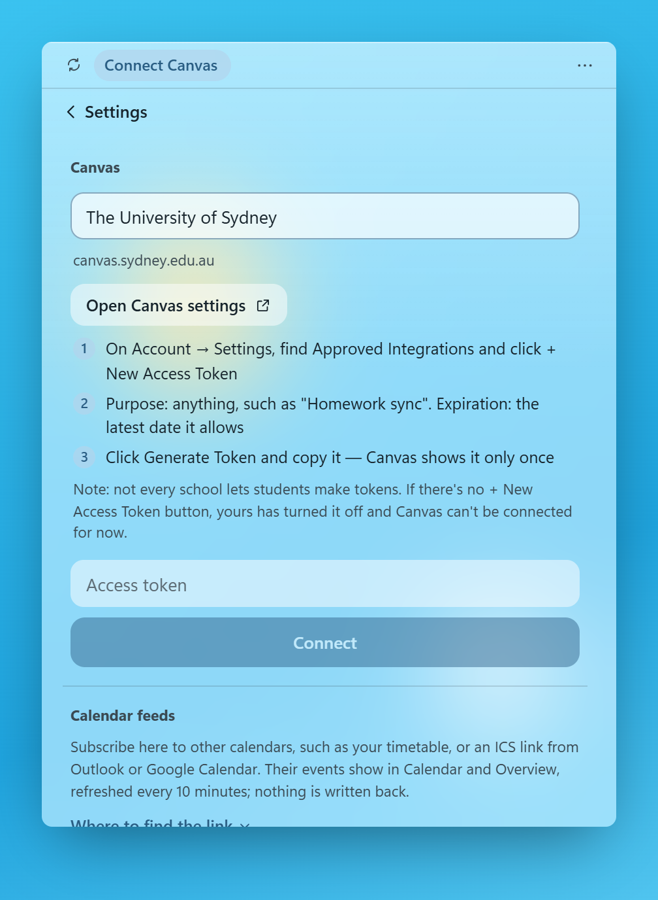 | 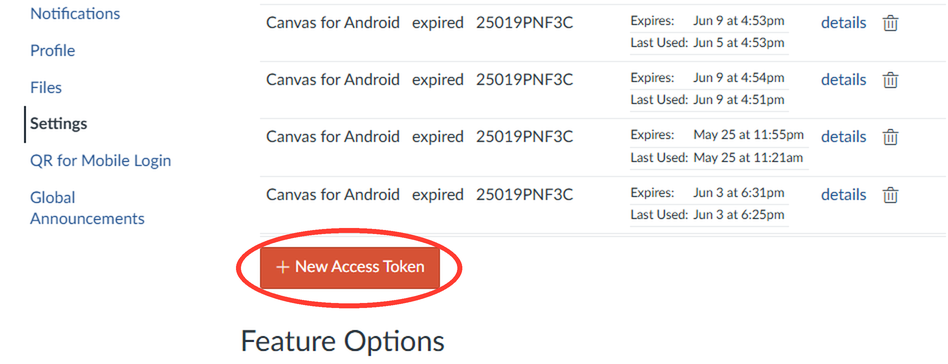 |

Didn't land there? In Canvas, click your profile picture on the left → **Settings**.

### Step 3: Generate the token and copy it

1. **Purpose**: anything, such as "Homework sync".
2. **Expiration**: the latest date it allows; any time.
3. Click **Generate Token** and copy the token. **Copy it right away: once the dialog is closed, the token can't be shown again.**

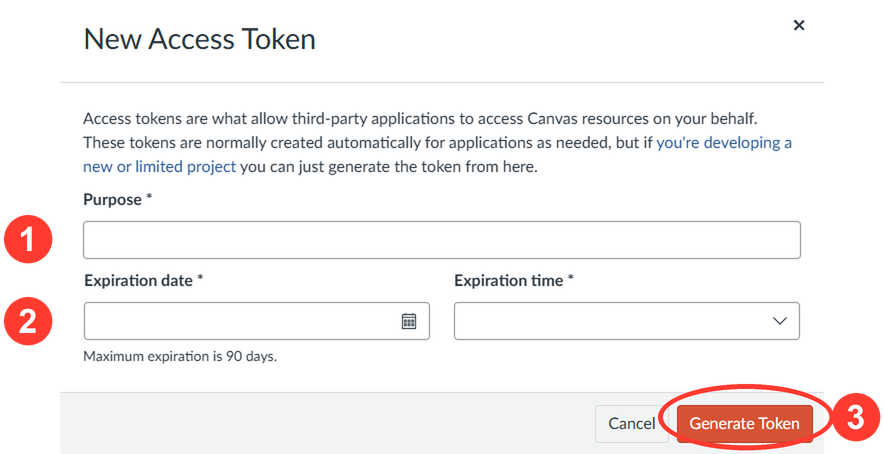

### Step 4: Paste and connect

Back in the widget, paste the token into the Access token box and click **Connect**. From then on it syncs every 10 minutes, and it reminds you to make a new token before this one expires.

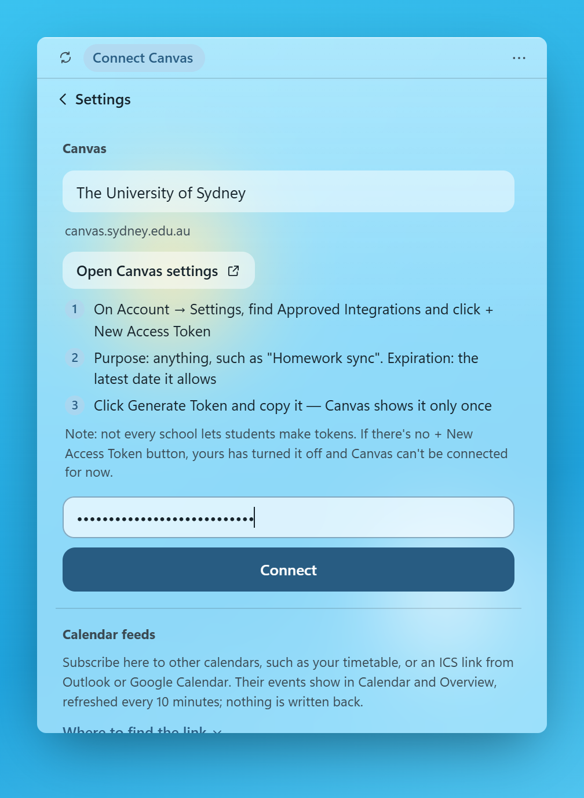

If Canvas's Settings page has no **+ New Access Token**, your school doesn't let students create tokens, and Still Today can't connect for now.

## Your data

- Everything stays on your computer. Still Today talks only to your Canvas and to the calendar feeds you add; there's no account and no server of mine in between.
- Tasks, focus history and settings are in `%LOCALAPPDATA%\StillToday` on Windows, or `~/Library/Application Support/app.stilltoday.widget` on a Mac.
- Your Canvas token and calendar feed links are kept in Windows Credential Manager or the Mac Keychain, not in a file.
- Uninstalling leaves your data in place, so reinstalling picks up where you were.

## Build from source

For Windows you'll need pnpm, the .NET 10 SDK, and, for the installer, Inno Setup 7.

```powershell
cd ui
pnpm install
pnpm dev        # the page in a normal browser, with a simulated desktop and sample data
pnpm test
cd ..
dotnet build host/StillToday.csproj -c Release
```

`scripts/packaging/Build-StillTodayInstaller.ps1` tests and builds everything and writes the installer to `artifacts/installer/`. [`packaging/README.md`](packaging/README.md) describes what it installs.

The Mac host is written with Tauri, in `mac/` on the [`mac` branch](../../tree/mac). You'll need pnpm and Rust:

```bash
cd ui && pnpm install && pnpm build
cd ../mac && cargo run
```

- `host/` is the Windows side: a borderless window that changes shape between views, the tray icon, the blur, notifications, storage and network access.
- `mac/` (on the `mac` branch) is the Mac side: Liquid Glass, the desktop level and grid placement, the menu bar icon, notifications, the Keychain and network access.
- `ui/` is the interface both share, in Svelte.
